# usdt-payments — приём и выплаты USDT в сети TRON

[Русский](#русский) · [English](#english)

## Русский

Платёжная система для приёма и отправки USDT (TRC-20), которую вы запускаете на своём компьютере или сервере. Веб-админка позволяет выдавать адреса для оплаты, отслеживать поступления, собирать средства и управлять выплатами. Ключи и данные хранятся на вашей установке.

Руководство ведёт от установки до первого платежа в **mainnet**. Настройка тестовой сети описана в конце.

**[Первый запуск](#1-подготовьте-компьютер):** шаги 1–6. **[Работа с деньгами](#7-создайте-адрес-для-получения-usdt):** шаги 7–9. **[Бэкап и восстановление](#10-сохраняйте-полный-бэкап):** шаги 10–11.

### Сначала: какие адреса здесь есть

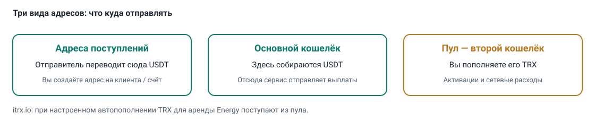

| Что | Для чего | Что туда отправлять |
|---|---|---|
| **Адреса поступлений** | Отдельный адрес для клиента или счёта; вы создаёте их в админке | Клиент отправляет **USDT, сеть TRON / TRC-20** |
| **Основной кошелёк** | Здесь собираются полученные USDT; отсюда идут выплаты | Сервис собирает сюда USDT с адресов поступлений |
| **Пул — второй кошелёк** | Оплачивает активации адресов и сетевые расходы | Вы пополняете его **TRX в сети TRON** |
| **Аккаунт itrx.io** | Аренда Energy для переводов USDT | При настроенном автопополнении нужные TRX переводятся из пула |

Основной кошелёк, пул и адреса поступлений создаются из одной seed-фразы. Вторую фразу для пула создавать не нужно. Аккаунты TronGrid и itrx.io — внешние сервисы; кошелёк в них не хранится.

Скриншоты ниже показывают **настоящий интерфейс с демонстрационными данными**. Адреса на них вымышленные: свои адреса копируйте из работающей админки.

### 1. Подготовьте компьютер

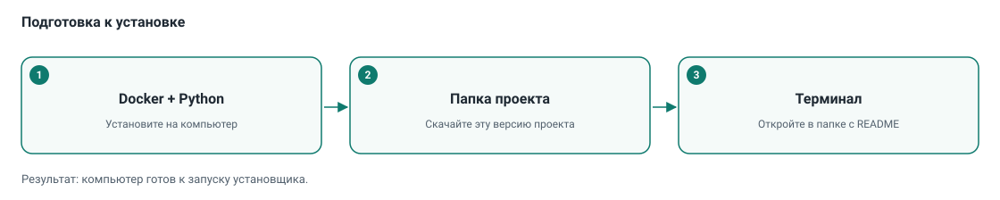

1. Установите Docker с Docker Compose и Python ≥ 3.9. На macOS можно использовать OrbStack; cron и `lsof` уже есть в системе. На Linux нужны установленные и работающие cron, а также `lsof`.
2. Скачайте проект и распакуйте его в отдельную папку.
3. Откройте терминал **в этой папке**, рядом с README. Все команды ниже вводятся здесь.

### 2. Зарегистрируйтесь в TronGrid и получите API key

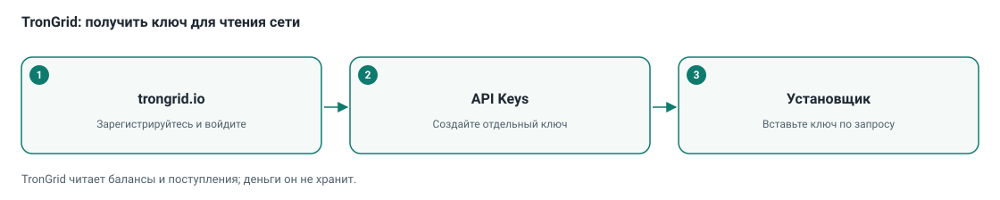

1. Откройте [trongrid.io](https://www.trongrid.io/) и зарегистрируйтесь.
2. Войдите, откройте **API Keys** и создайте отдельный ключ для платёжки.
3. Скопируйте **API key**: установщик спросит его на следующем шаге.

TronGrid нужен для балансов и поиска поступлений. Без ключа запросы могут ограничиваться: балансы не загружаются, сканер замедляется. Ключ также подчиняется лимитам вашего тарифа. [Инструкция TronGrid](https://developers.tron.network/reference/select-network).

### 3. Установите и откройте админку

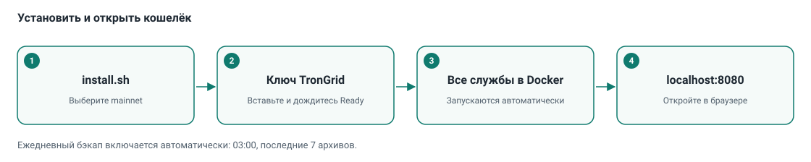

В терминале выполните:

```bash
./scripts/install.sh --network mainnet
```

На запрос `Paste your TronGrid API key` вставьте ключ и нажмите Enter. **Ввод скрыт — это нормально.** Дождитесь сообщения `Ready`.

Установщик создаёт конфигурацию, генерирует пароли служб, запускает весь проект в Docker и включает ежедневный бэкап. Существующий файл `.env` сохраняется; `--network` выбирает сеть только для новой установки.

Откройте **http://localhost:8080**. В OrbStack также доступен **https://usdt.local**. Должна появиться страница первого запуска с проверкой сети.

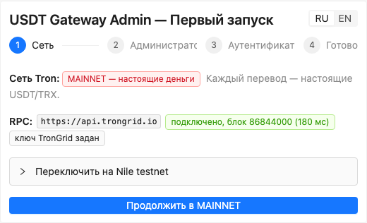

### 4. Настройте вход и создайте кошелёк

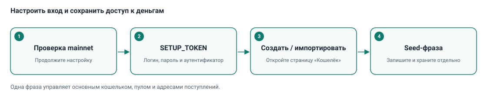

1. На первой странице убедитесь, что выбрана **MAINNET** и подключение к TronGrid работает. Нажмите **«Продолжить в MAINNET»**.
2. Откройте файл **`.env`** в папке проекта текстовым редактором. На macOS скрытые файлы показываются через **⌘⇧.**
3. Скопируйте значение после `SETUP_TOKEN=` и вставьте в форму настройки. Придумайте логин и пароль.
4. Отсканируйте QR-код приложением-аутентификатором и подтвердите шестизначный код.
5. На странице **«Кошелёк»** нажмите **«Создать новый кошелёк»** или импортируйте существующую seed-фразу.
6. Запишите показанные слова — **seed-фразу** — и храните отдельно от компьютера. Она показывается один раз. Подтвердите, что сохранили её, и продолжите.

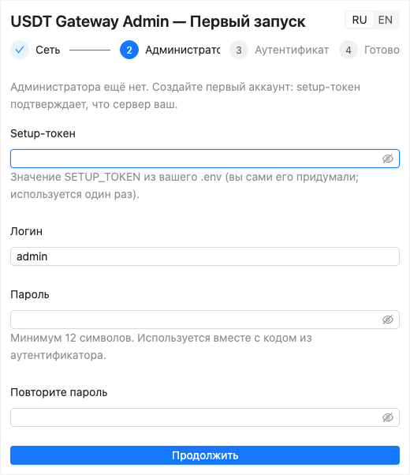

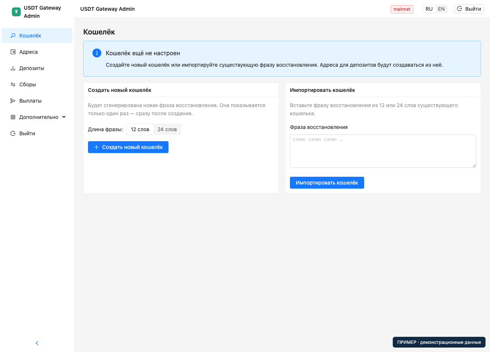

После создания появятся **основной кошелёк** и **пул TRX**.

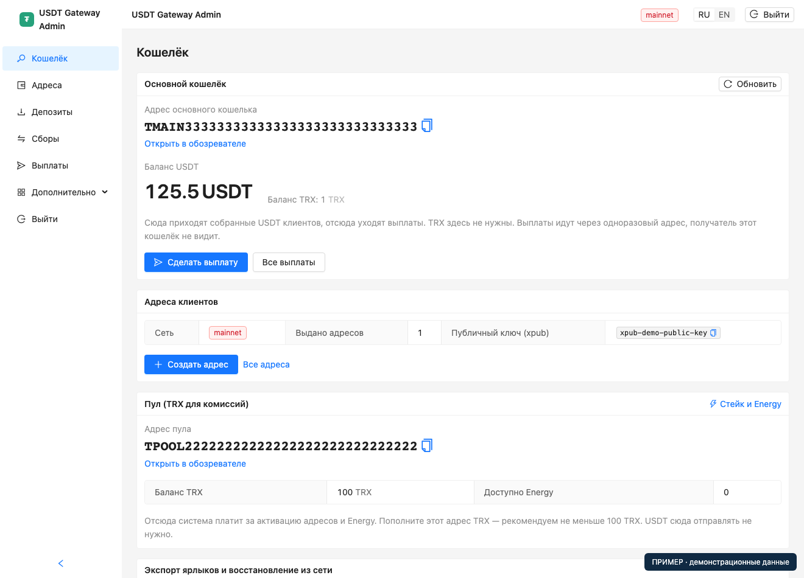

Для последующих входов нужны пароль и код аутентификатора. Не передавайте другим людям seed-фразу, `.env` и архивы бэкапа.

### 5. Подключите аренду Energy через itrx.io

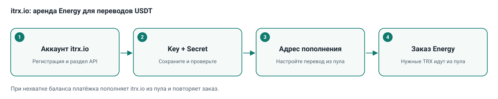

Energy — ресурс сети для переводов USDT. Для начала можно арендовать его через itrx.io, без собственного стейкинга.

1. [Зарегистрируйтесь на itrx.io](https://itrx.io/en/buyer/register) и войдите.
2. В личном кабинете откройте **API**, создайте доступ и скопируйте **API key** и **API secret**. Нужны оба значения. [Документация itrx.io](https://develop.itrx.io/zh/api/order-create.html).
3. В админке кошелька откройте **«Дополнительно» → «Настройки» → «Аренда Energy — itrx.io»**.
4. Вставьте оба значения, включите **«Использовать itrx.io первым»** и выберите **1 час**.
5. Нажмите **«Сохранить»** внизу формы, затем **«Проверить подключение»**.
6. В кабинете itrx.io скопируйте **адрес пополнения своего аккаунта**. В `.env` задайте `ITRX_DEPOSIT_ADDRESS=ваш_адрес` и добавьте этот же адрес в `POOL_TRUSTED_RECIPIENTS` (несколько адресов разделяются запятыми). Примените настройки командой `docker compose --profile full up -d core signer watcher`.

Когда для заказа Energy не хватает баланса itrx.io, платёжка переводит TRX **из пула на адрес пополнения аккаунта**, ждёт зачисления и повторяет заказ. Сумма рассчитывается под заказ с небольшим запасом; по умолчанию пополнение составляет от 10 до 100 TRX. На следующем шаге вы пополняете пул — заказы Energy оплачиваются автоматически.

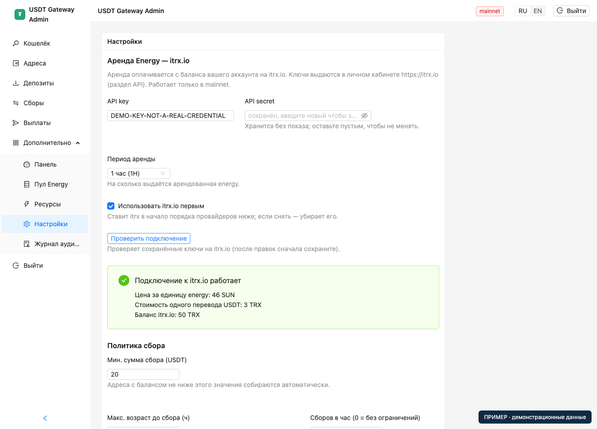

Если вы используете собственный стейкинг TRX под Energy, itrx.io можно не подключать. Без настроенного адреса автопополнения аренда оплачивается из уже имеющегося баланса itrx.io.

### 6. Пополните второй кошелёк — пул TRX

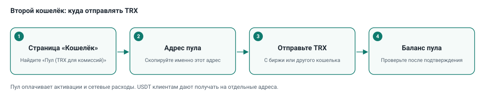

1. Откройте страницу **«Кошелёк»** и прокрутите до карточки **«Пул (TRX для комиссий)»**.
2. Скопируйте **«Адрес пула»** кнопкой рядом с адресом.
3. С биржи или другого кошелька отправьте на него **TRX в сети TRON**. Из пула также оплачивается автопополнение itrx.io, если оно настроено.
4. После подтверждения проверьте **«Баланс TRX»** в этой карточке. Пока пула недостаточно для расходов, интерфейс показывает предупреждение.

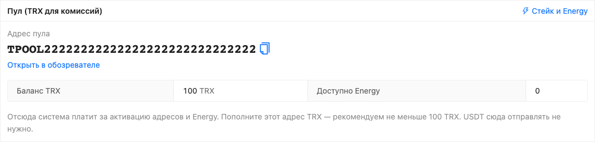

Пул оплачивает активации новых адресов и необходимые расходы сети, даже когда Energy арендуется через itrx.io. Если Energy берётся из собственного пула, TRX также используется для стейкинга. **Адрес пула не нужно давать клиенту для получения USDT.**

### 7. Создайте адрес для получения USDT

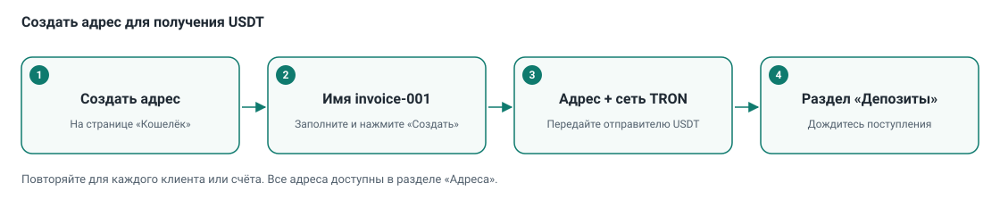

1. На странице **«Кошелёк»**, в карточке **«Адреса клиентов»**, нажмите **«Создать адрес»**.
2. Введите имя, например **`invoice-001`**. Используйте латинские буквы, цифры, `-`, `_`, `.`, `:`. Дополнительные данные можно не заполнять.
3. Нажмите **«Создать»**. На странице появится созданный адрес — скопируйте его.
4. Передайте клиенту **этот адрес** и явно укажите: **USDT, сеть TRON / TRC-20**.
5. Дождитесь подтверждения в сети. Поступление появится в разделе **«Депозиты»**.

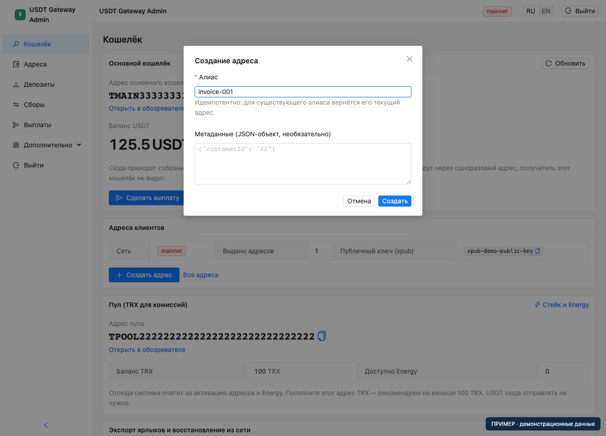

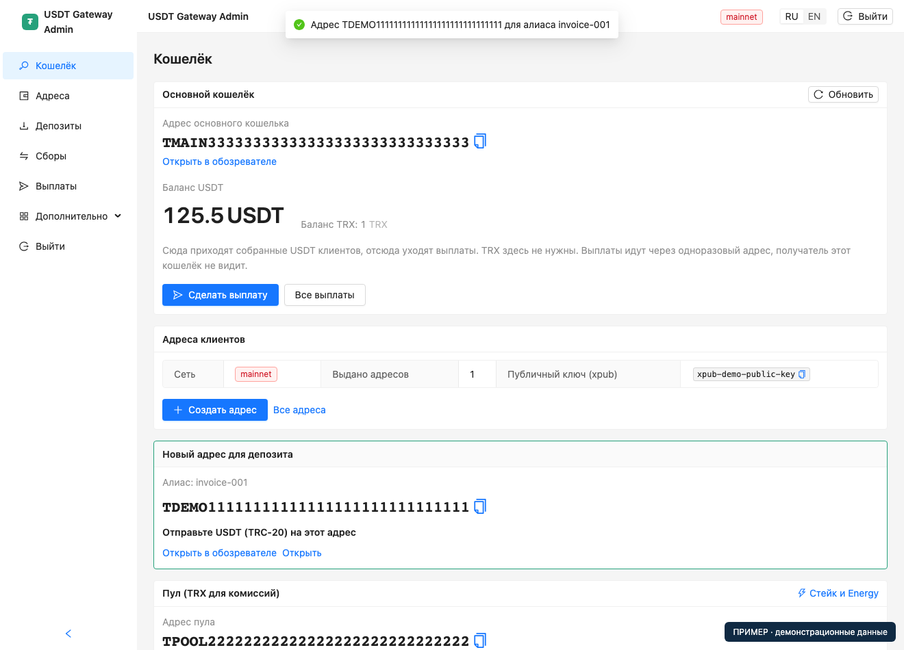

Для каждого нового счёта используйте отдельное имя и адрес: так поступление легко связать с нужной оплатой. Если клиенту нужен постоянный адрес, можно выдать его один раз — последующие переводы на него тоже появятся в «Депозитах».

Имя закрепляется за адресом: повторное создание с тем же именем вернёт уже выданный адрес. Все адреса, имена и балансы доступны в разделе **«Адреса»**.

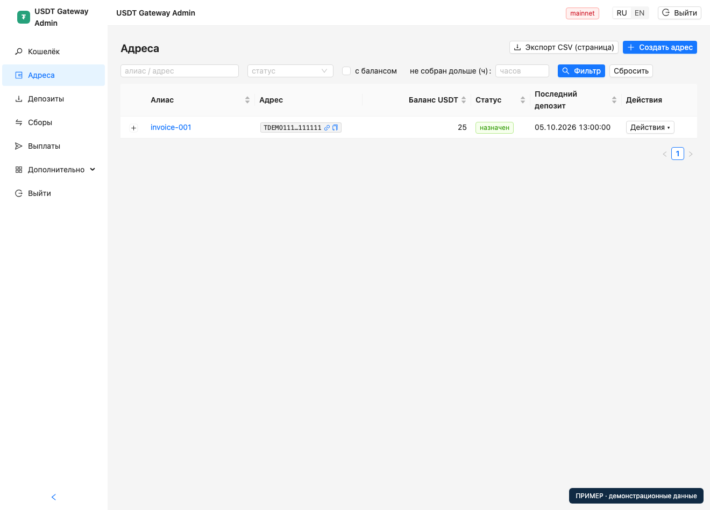

### 8. Проверьте поступление и сбор на основной кошелёк

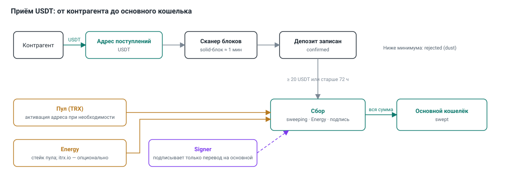

1. Откройте **«Депозиты»**: проверьте имя адреса, сумму и статус `confirmed`.
2. По умолчанию сервис собирает USDT на основной кошелёк при накоплении **20 USDT** или через **72 часа**. Порог меняется в настройках.
3. Если нужно собрать раньше, откройте нужный адрес в разделе **«Адреса»** и нажмите **«Собрать сейчас»**.
4. В разделе **«Сборы»** дождитесь `confirmed`. Депозит станет `swept`; баланс основного кошелька увеличится.

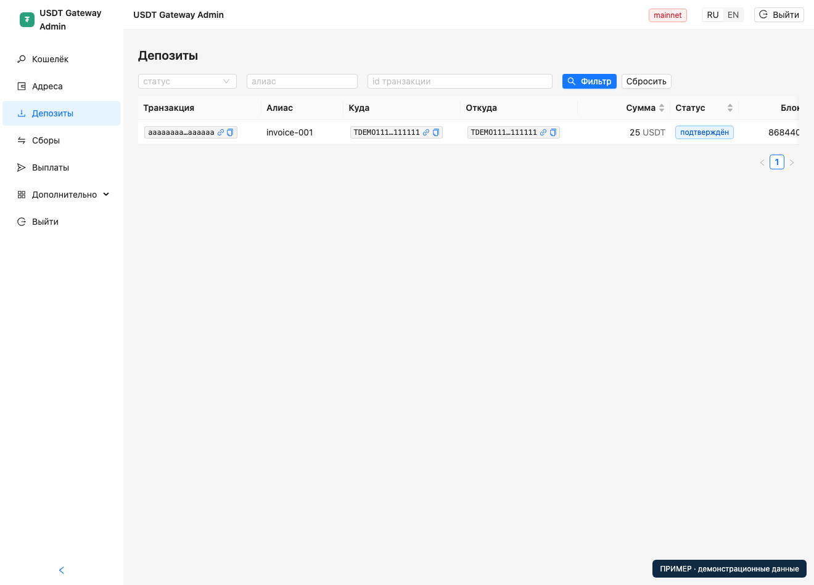

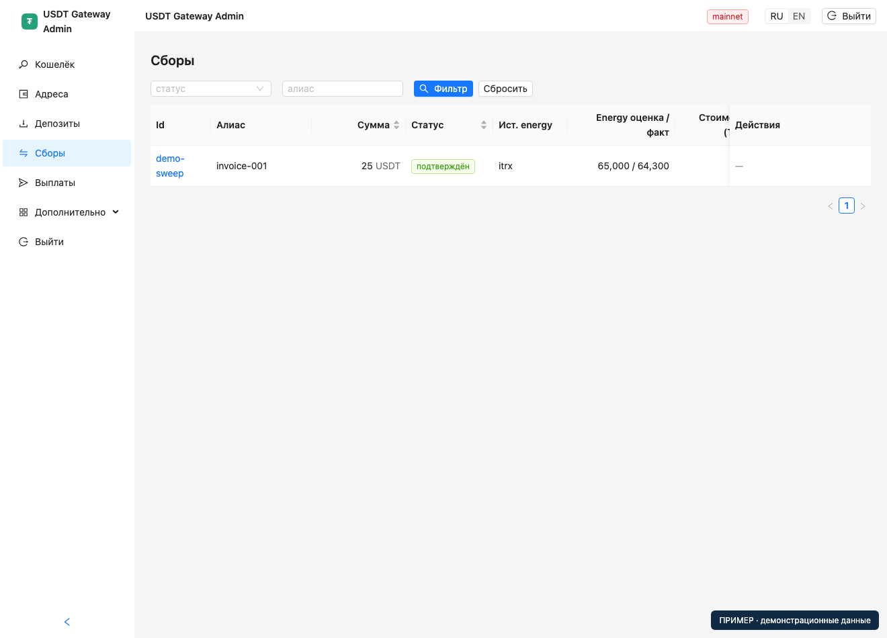

При первой проверке используйте небольшую сумму. Для сборов должны работать обработчики очередей — см. подсказку про `RUN_WORKERS` ниже.

### 9. Отправьте выплату

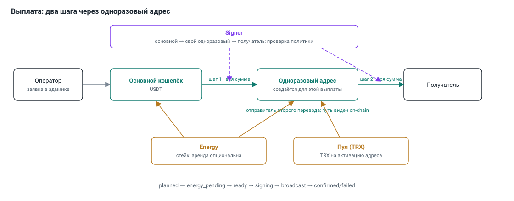

1. Откройте **«Выплаты» → «Новая выплата»** или кнопку **«Сделать выплату»** на странице кошелька.
2. Введите адрес получателя в сети TRON и сумму USDT. Проверьте их перед отправкой.
3. Укажите номер выплаты: повтор с тем же номером не создаст вторую выплату. Заметку можно оставить пустой.
4. Отправьте заявку. Для этой выплаты сервис автоматически создаст отдельный промежуточный адрес и переведёт средства в два этапа: **основной кошелёк → промежуточный адрес → указанный адрес получателя**.
5. Дождитесь итогового статуса **`confirmed`**: это подтверждение второго этапа. Статус первого этапа ещё не означает завершения выплаты.

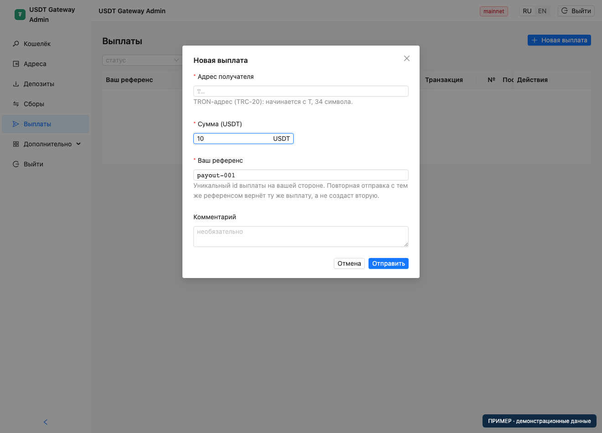

На основном кошельке должны быть USDT, в пуле — TRX для необходимых расходов, а для Energy — доступный выбранный провайдер. Для обработки выплат должны работать обработчики очередей.

### 10. Сохраняйте полный бэкап

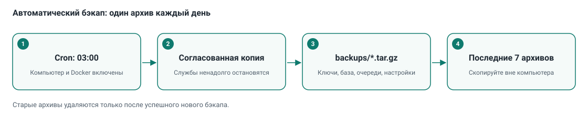

После установки бэкап создаётся **ежедневно в 03:00 по времени компьютера**. В `backups/` хранятся **последние 7 архивов**; старые удаляются только после успешного нового бэкапа. Компьютер и Docker должны работать в это время.

**Расписание настраивает сам установщик — вручную добавлять cron не нужно.** Повторный запуск установки обновляет расписание без дублирования задания.

Чтобы сделать бэкап прямо сейчас:

```bash
./scripts/backup.sh
```

Службы ненадолго остановятся и включатся обратно. Скопируйте файл **`backups/usdt-trx-<дата>.tar.gz`** в защищённое место вне компьютера. Отчёт об автоматических бэкапах находится в **`backups/daily.log`**. Ручные архивы в `backups/` входят в те же 7 сохраняемых копий.

Полный архив содержит ключи кошелька, базу, историю, настройки, очереди, логин и 2FA. Храните его как доступ к деньгам. Seed-фразу держите отдельно. **«Скачать ярлыки» в админке не заменяет полный бэкап.**

### 11. Восстановите платёжку из бэкапа

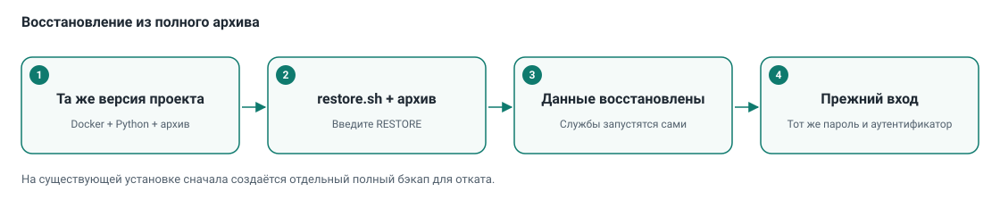

1. Подготовьте новый компьютер по шагу 1 (Docker, Python, cron и `lsof`). Скачайте **ту же версию проекта** и откройте терминал в его папке.
2. Скопируйте архив в папку проекта. Выполните команду, подставив имя своего файла:

```bash
./scripts/restore.sh ./usdt-trx-20261005-120000.tar.gz
```

3. Напечатайте **`RESTORE`**, когда скрипт попросит подтверждение. Дождитесь завершения.
4. Откройте админку и войдите с **прежним паролем и прежним аутентификатором**. Адреса, пул, ключи и данные вернутся вместе; импортировать seed заново не нужно. Ежедневное расписание бэкапов также включится.

Восстановление заменяет текущие данные. На существующей установке скрипт сначала создаёт полный архив для отката в `backups/`. При ошибке восстановления сервисы остаются остановленными: устраните причину и повторите команду или восстановите архив для отката.

**Если остались только слова:** установите проект заново и импортируйте seed-фразу. «Восстановить из сети» может восстановить часть записей, но не логин, настройки и полную историю. Оно может также запустить возврат средств с одноразовых адресов выплат.

### Если что-то не работает

| Что видно | Что проверить |
|---|---|
| Не открывается админка / 502 | Дождитесь `Ready`, обновите вкладку; в OrbStack попробуйте http://localhost:8080 |
| Балансы не загрузились | `TRONGRID_API_KEY` в `.env`; при `429` — лимиты TronGrid |
| Нет поступления | Клиент использовал выданный адрес и сеть TRON; watcher работает и догнал сеть |
| Сбор или выплата ждёт Energy | Сохранены оба ключа itrx.io, есть баланс в его кабинете, выбран нужный провайдер |
| Нет TRX на активацию | Пополнен **пул кошелька**, а не только аккаунт itrx.io |
| Поступления видны, заявки не выполняются | `RUN_WORKERS=false` оставляет watcher, но отключает обработку сборов и выплат; для обычной работы нужно `true` |
| Не появился ночной бэкап | Компьютер и Docker работали в 03:00; проверьте `backups/daily.log` |

Чтобы применить изменения `.env`:

```bash
docker compose --profile full up -d --wait
```

Чтобы остановить проект, сохранив данные:

```bash
docker compose --profile full stop
```

Службы автоматически запускаются после перезапуска Docker. Технические подробности и отдельная тестовая установка — ниже.

<details>
<summary>Технические подробности и разработка</summary>

`RUN_WORKERS=false` выключает обработчики очередей и планировщик; **watcher остаётся включённым**. Для полного отключения сканера используйте `docker compose --profile full stop watcher`.

Watcher проверяет новые подтверждённые блоки раз в **15 секунд** (`WATCHER_POLL_MS=15000`), затем читает все блоки после сохранённой позиции. Платежи не пропускаются; к задержке подтверждения сети добавляется до 15 секунд ожидания проверки. Частоту можно изменить в `.env`; после этого пересоздайте watcher: `docker compose --profile full up -d --force-recreate watcher`.

`PORT` задаёт порт API на хосте; если 3000 занят, укажите 3001. `ADMIN_PORT` задаёт порт админки (по умолчанию 8080). Внутри Docker Core всегда слушает 3000; signer доступен только во внутренней сети. Compose задаёт контейнерные пути к seed, ключу пула и ярлыкам.

TronGrid: `TRONGRID_API_KEY`; mainnet — `NETWORK=mainnet`, `TRON_RPC_URLS=https://api.trongrid.io`. Ключ применяется и к RPC, и к запросам истории. Для itrx.io можно задать `ITRX_API_KEY`, `ITRX_API_SECRET`, `ITRX_RENT_PERIOD=1H`, `PROVIDER_ORDER=itrx,own_pool` в `.env`, но сохранённые настройки из админки имеют приоритет. Callback необязателен, `ITRX_CALLBACK_URL` можно оставить пустым. Без itrx.io используйте `PROVIDER_ORDER=own_pool` и стейкинг пула под Energy.

Первую установку без терминального диалога можно выполнить с переменной окружения `TRONGRID_API_KEY`. Существующий `.env` никогда не перезаписывается установщиком. Для всех скриптов нужны Python ≥ 3.9, Docker Compose, cron (`crontab`) и `lsof`; сторонние Python-пакеты не нужны.

Бэкап включает дамп Postgres, файлы Redis, `.env`, `secrets/`, ярлыки и аудит подписанта. Контрольные суммы проверяются до восстановления. Команды бэкапа и восстановления предназначены для Docker-стека: сначала остановите сервисы, запущенные на хосте. Можно задать путь архива: `./scripts/backup.sh /путь/кошелёк.tar.gz`.

Диагностика:

```bash
docker compose --profile full ps
docker compose --profile full logs -f core watcher
```

Локальная разработка (Node ≥ 22, pnpm ≥ 10):

```bash
pnpm install
cp .env.example .env  # только если .env ещё нет
# Задайте SEED_PASSPHRASE, SIGNER_TOKEN и SETUP_TOKEN.
docker compose up -d postgres redis
pnpm --filter @usdt-trx/shared build
pnpm db:generate
pnpm db:migrate
# Четыре отдельных терминала:
pnpm dev:signer
pnpm dev:core
pnpm dev:watcher
pnpm dev:admin
```

Prisma читает корневой `.env`. `CORE_URL` задаёт адрес API для dev-прокси админки (:5173). `docker-compose.local.yml` — дополнительный nginx только для сервисов на хосте; после изменения `PORT` пересоздайте его с `--force-recreate`. Не запускайте этот вариант одновременно с полным Docker-стеком.

Проверки:

```bash
pnpm test
pnpm typecheck
python3 -m unittest discover -s scripts -p 'test_stack.py'
STACK_INTEGRATION=1 python3 -m unittest discover -s scripts -p 'test_stack.py'
```

Последняя команда проверяет установку, бэкап и восстановление на отдельном стеке без публикации портов и с тестовым кошельком. Сначала соберите образы: `docker compose --profile full build`.

API: [docs/admin-api.md](docs/admin-api.md). Параметры: [.env.example](.env.example). Диаграммы обновляются командой `python3 docs/diagrams/generate.py`; [обновление скриншотов](docs/screenshots/README.md).

### Как это устроено

По умолчанию одна seed-фраза порождает все кошельки. Подписант хранит seed в зашифрованном файле и использует ключи в памяти; Core получает публичные адреса и xpub.

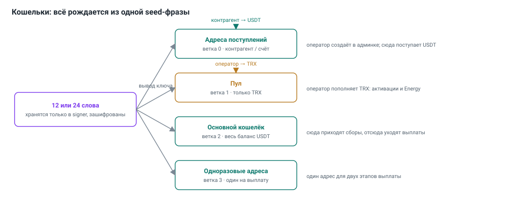

| Кошелёк | Ветка | Что хранит | Кто пополняет |
|---|---|---|---|
| Адреса поступлений | 0 | USDT до сбора; отдельный адрес на контрагента/счёт | контрагент |
| Пул | 1 | TRX на активации, bandwidth и стейкинг под Energy | оператор |
| Основной кошелёк | 2 | USDT: сюда сборы, отсюда выплаты | сборы |
| Одноразовые адреса выплат | 3 | USDT между двумя этапами выплаты | основной кошелёк |

**Приём USDT.** Оператор создаёт адрес в админке и передаёт его контрагенту. Watcher обнаруживает перевод в solid-блоке. Статусы депозита: `confirmed → sweeping → swept`; сумма ниже минимального порога получает `rejected` (dust). Сбор запускается при достижении порога (по умолчанию 20 USDT), по возрасту поступления (72 ч) или кнопкой «Собрать сейчас». Система активирует адрес при необходимости, получает Energy, запрашивает подпись и переводит USDT на основной кошелёк. Energy берётся из собственного стейка TRX пула; аренда itrx.io необязательна.


**Выплаты.** Оператор создаёт выплату в админке. Этап 1: основной кошелёк → одноразовый адрес; этап 2: одноразовый адрес → получатель. Для каждого этапа нужна Energy. Подписант проверяет, что первый перевод направлен на соответствующий одноразовый адрес. Отправителем второго перевода служит этот адрес; оба перевода видны в блокчейне.


**Где что хранится.** Seed и приватные ключи находятся в изолированном подписанте. Он подписывает только транзакции, прошедшие проверку политики: сборы, оба этапа выплат и разрешённые операции пула. Core ведёт учёт; база не содержит приватных ключей кошелька.

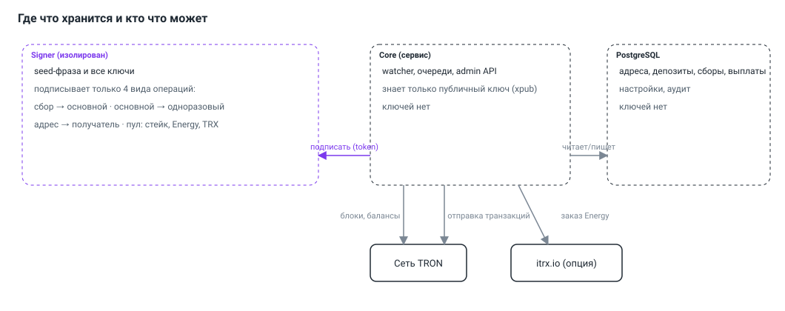


</details>

<details>
<summary>Необязательно: тестовая сеть Nile</summary>

Для отдельной новой установки без настоящих средств:

```bash
./scripts/install.sh --network nile
```

Установщик создаст конфигурацию Nile с собственным пулом Energy. itrx.io работает в mainnet и здесь не нужен. Не переключайте существующий боевой кошелёк ради тестирования.

**Создать или импортировать кошелёк** — «Кошелёк» → «Создать новый кошелёк». Запишите показанную **один раз** seed-фразу и храните её отдельно. «Импортировать кошелёк» принимает существующую фразу. Подписант сохраняет seed в зашифрованном `SEED_FILE`. Адреса пула и основного кошелька доступны в админке.

**Тестовые монеты с крана** — [Nile faucet](https://nileex.io/join/getJoinPage).

- Запросите тестовые TRX на адрес **пула** из админки: для активаций, bandwidth и стейкинга.
- После создания адреса запросите тестовые USDT на созданный адрес поступлений. Доступные суммы и ограничения указаны на странице крана.

**Создать адрес поступлений** — «Кошелёк» → «Создать адрес», alias, например `invoice-1`. Используйте отдельный адрес на контрагента или счёт. Адрес также виден в разделе «Адреса»; для теста вставьте его в кран USDT.

**Застейкать TRX пула под Energy** — «Пул Energy» → Stake → ENERGY. Например, при балансе 1000 тестовых TRX можно застейкать 800, оставив остаток на активации и bandwidth. Дождитесь доступной Energy на странице пула. Нужный стейк зависит от ресурсов сети; при недостатке Energy сбор ожидает ресурсы и может завершиться ошибкой.

**Смотреть поступление и сбор**

- После обнаружения перевода watcher'ом депозит появляется в «Депозиты» со статусом `confirmed`.
- При выполнении условий сбор стартует автоматически: `planned → activating → energy_pending → ready → signing → broadcast → confirmed`. Ссылка на транзакцию ведёт в Tronscan.
- Депозит проходит `sweeping → swept`, USDT поступает на основной кошелёк. Делегированная Energy освобождается после сбора; расход Energy восстанавливается по правилам сети.

Если что-то не так: «Сборы» → «Ошибка», Retry / Rebuild; «Ресурсы» показывает операции Energy; лог подписанта — `signer-audit.log`.


</details>

---

## English

A self-hosted payment system for receiving and sending USDT (TRC-20). The web admin lets you issue payment addresses, track deposits, collect funds and manage payouts. Keys and data remain on your installation.

This guide takes you from installation to your first payment on **mainnet**. Testnet setup is covered at the end.

**First launch:** steps 1–6. **Daily use:** steps 7–9. **Backup and restore:** steps 10–11.

### First: which addresses are used

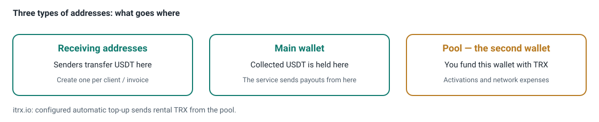

| What | Purpose | What goes there |
|---|---|---|
| **Receiving addresses** | Create one per client or invoice | Clients send **USDT on TRON / TRC-20** |
| **Main wallet** | Holds collected USDT and sends payouts | The service collects USDT here |
| **Pool — the second wallet** | Pays for activations and network expenses | You send **TRX on TRON** here |
| **itrx.io account** | Pays for Energy rental | Configured automatic top-up transfers TRX from the pool |

The main wallet, pool and receiving addresses share one seed phrase. Do not create a second phrase for the pool. TronGrid and itrx.io are external services; they do not hold this wallet.

Screenshots show the **real interface with demonstration data**. Screenshot addresses are fictional; copy your own addresses from the running admin.

### 1. Prepare your computer

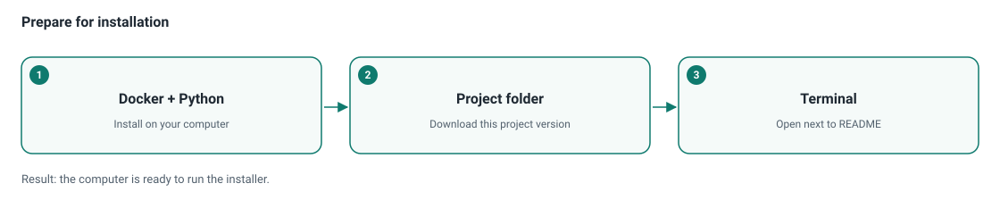

1. Install Docker with Compose and Python ≥ 3.9. OrbStack works on macOS, which already has cron and `lsof`. Linux needs running cron and `lsof` installed.
2. Download and unpack the project into its own folder.
3. Open a terminal **in that folder**, next to README. Run every command below there.

### 2. Register with TronGrid and get an API key

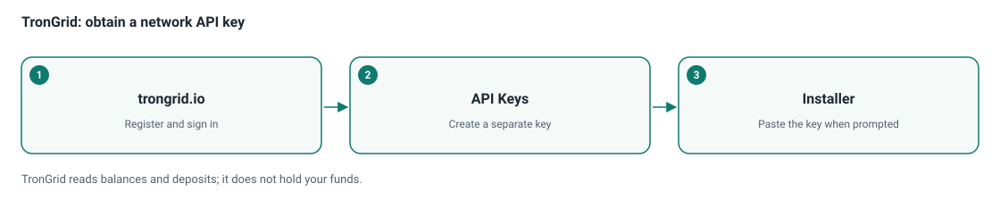

1. Register at [trongrid.io](https://www.trongrid.io/).
2. Sign in, open **API Keys** and create a separate key for this payment system.
3. Copy the **API key**: the installer asks for it next.

TronGrid reads balances and finds deposits. Without a key, requests can be severely limited; a key still follows your plan limits. [TronGrid instructions](https://developers.tron.network/reference/select-network).

### 3. Install and open admin

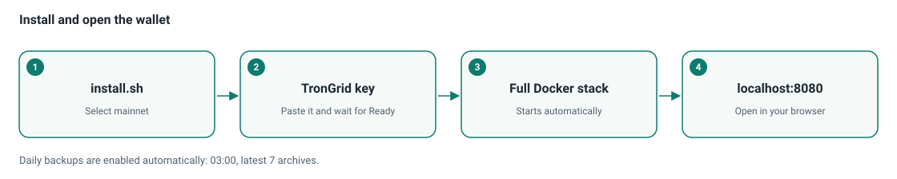

```bash
./scripts/install.sh --network mainnet
```

At `Paste your TronGrid API key`, paste the key and press Enter. **Input is hidden.** Wait for `Ready`.

The installer generates configuration and service passwords, starts the complete Docker stack and enables daily backups. An existing `.env` is preserved; `--network` selects the network only for a fresh installation.

Open **http://localhost:8080**, or **https://usdt.local** with OrbStack. The first-run page checks the network connection.

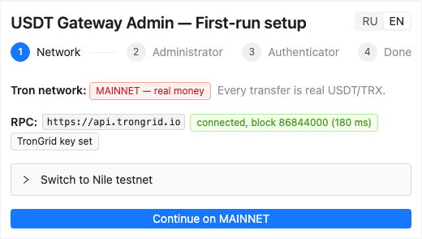

### 4. Set up login and create the wallet

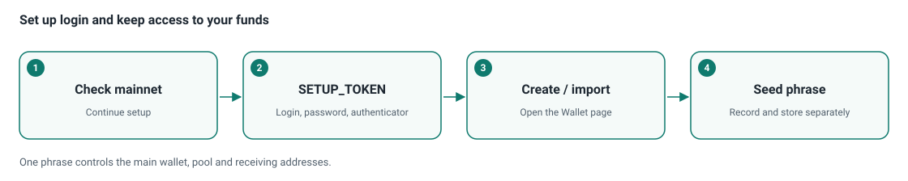

1. Check **MAINNET** and a working TronGrid connection. Click **Continue on MAINNET**.
2. Open **`.env`** in a text editor. On macOS, **⌘⇧.** shows hidden files.
3. Copy the value after `SETUP_TOKEN=` into the setup form and choose your login and password.
4. Scan the QR code in an authenticator app and confirm its six-digit code.
5. On **Wallet**, create a new wallet or import an existing phrase.
6. Record the **seed phrase**, shown once, and store it away from the computer. Confirm that you saved it and continue.

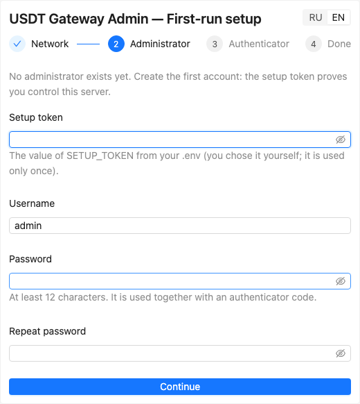

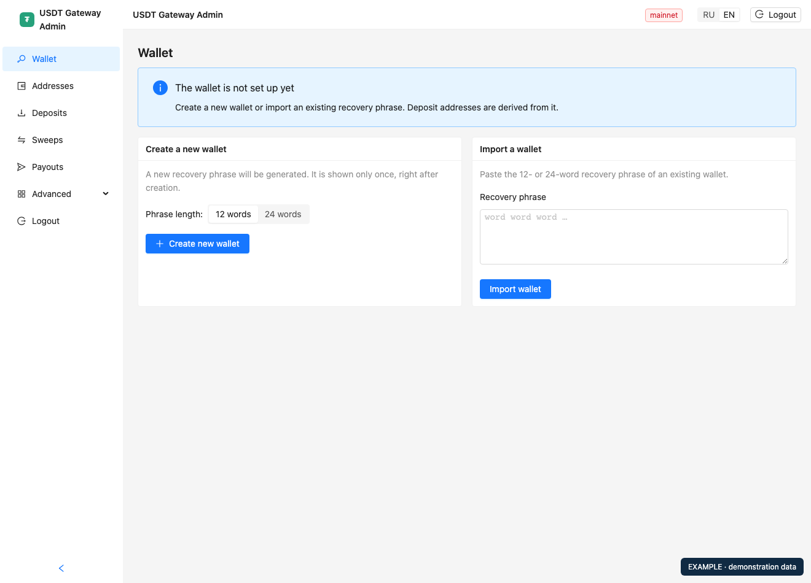

The **main wallet** and **TRX pool** now appear.

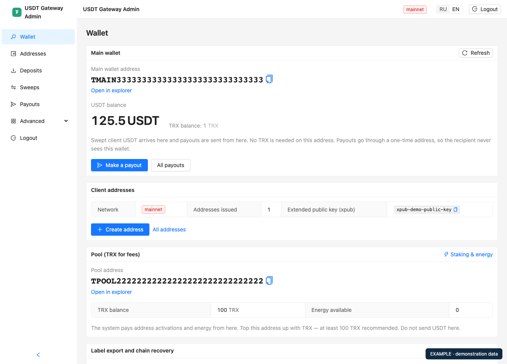

Future login requires your password and authenticator code. Keep the phrase, `.env` and backup archives private.

### 5. Connect Energy rental through itrx.io

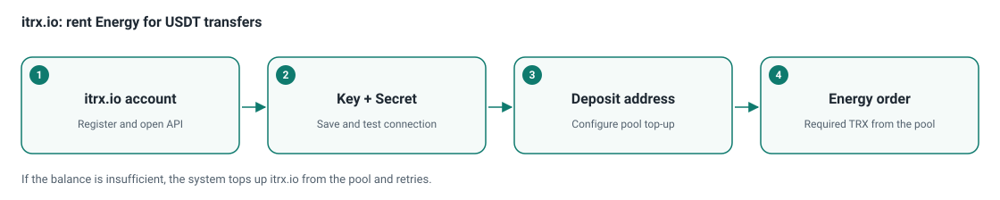

Energy is a network resource consumed by USDT transfers. You can rent it through itrx.io without staking your own TRX.

1. [Register at itrx.io](https://itrx.io/en/buyer/register) and sign in.
2. Open **API**, create credentials and copy both **API key** and **API secret**. [itrx.io documentation](https://develop.itrx.io/zh/api/order-create.html).
3. In wallet admin, open **Advanced → Settings → Energy rental — itrx.io**.
4. Enter both values, choose **Use itrx.io first** and **1 hour**.
5. Click **Save** at the bottom, then **Test connection**.
6. Copy your **account deposit address** from itrx.io. Set `ITRX_DEPOSIT_ADDRESS=your_address` in `.env` and add the same address to `POOL_TRUSTED_RECIPIENTS` (comma-separated if there are several). Apply the configuration with `docker compose --profile full up -d core signer watcher`.

When the itrx.io balance is insufficient for an Energy order, the payment system transfers TRX **from the pool to the account deposit address**, waits for credit and retries the order. The amount covers the order plus a small reserve, with a default range of 10–100 TRX per top-up. Fund the pool in the next step; Energy orders are paid automatically.

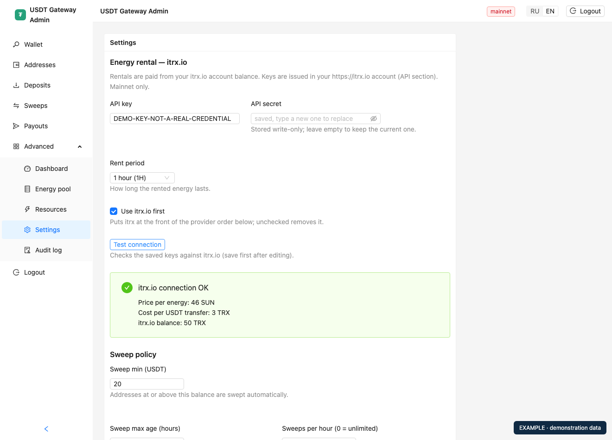

With your own TRX staking for Energy, itrx.io is optional. Without a configured top-up address, rentals use only the existing itrx.io balance.

### 6. Fund the second wallet — the TRX pool

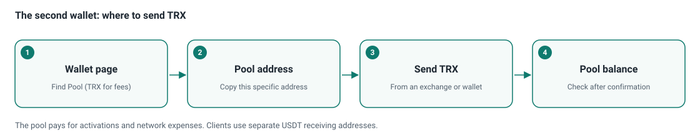

1. Open **Wallet** and scroll to **Pool (TRX for fees)**.
2. Copy the **Pool address** using the button beside it.
3. Send **TRX on TRON** from an exchange or another wallet. This pool also funds automatic itrx.io top-ups when configured.
4. After confirmation, check the card's **TRX balance**. The interface warns when the pool reserve is low.

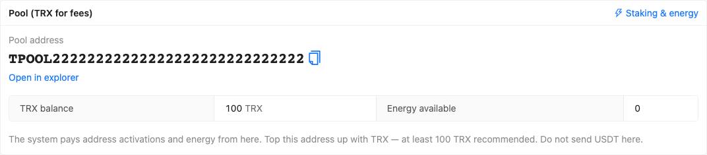

The pool pays for activations and necessary network expenses even with rented Energy. With your own pool Energy, its TRX also supplies staking. **Do not give the pool address to clients for USDT deposits.**

### 7. Create a USDT receiving address

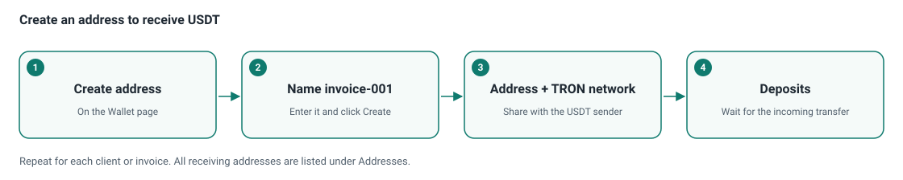

1. On **Wallet**, under **Client addresses**, click **Create address**.
2. Enter a name such as **`invoice-001`**. Use Latin letters, digits, `-`, `_`, `.`, `:`. Additional data is optional.
3. Click **Create**. Copy the address shown on the page.
4. Give the client **this address**, specifying **USDT on TRON / TRC-20**.
5. Wait for network confirmation. The transfer appears under **Deposits**.

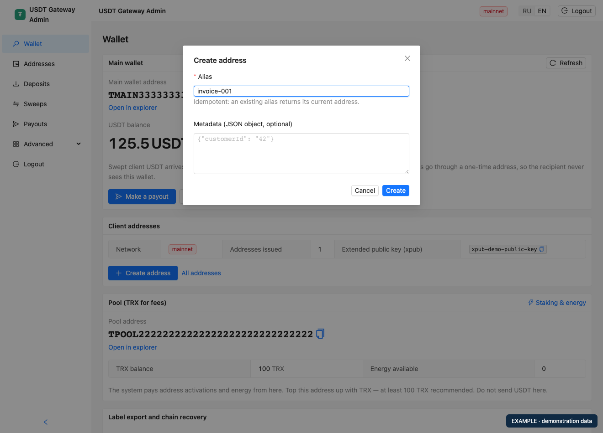

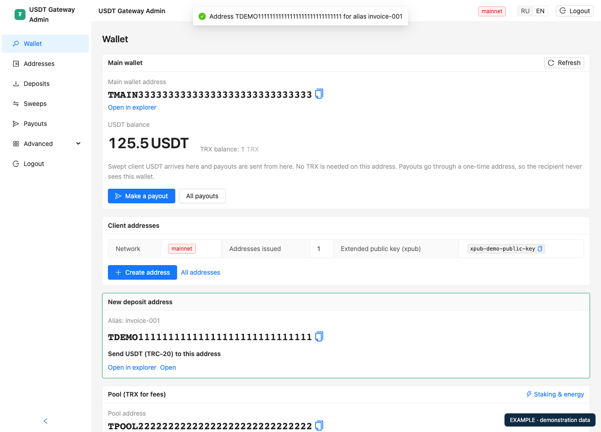

Use a separate name and address for each invoice to associate the deposit with its payment. For a client who needs a permanent address, issue one once; later transfers to it also appear under Deposits.

Each name stays linked to its address. Creating an address with the same name returns the existing one. All addresses, names and balances are under **Addresses**.

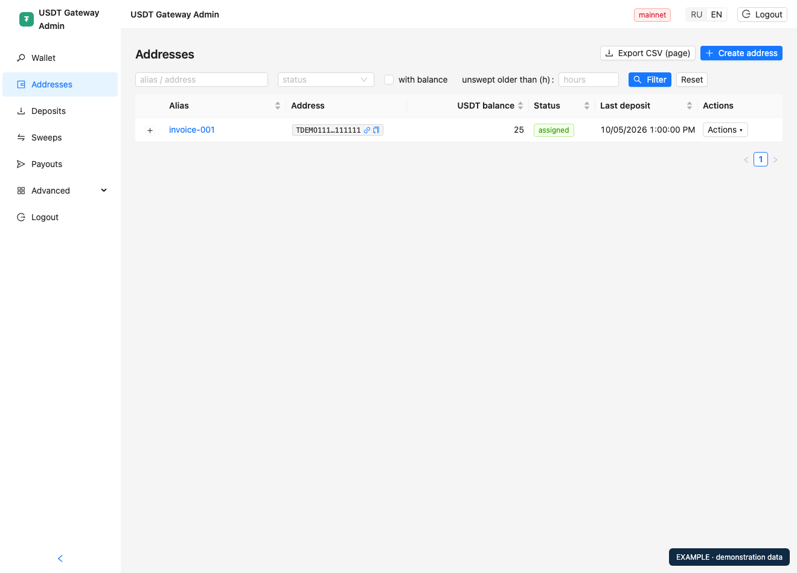

### 8. Check the deposit and collect into the main wallet

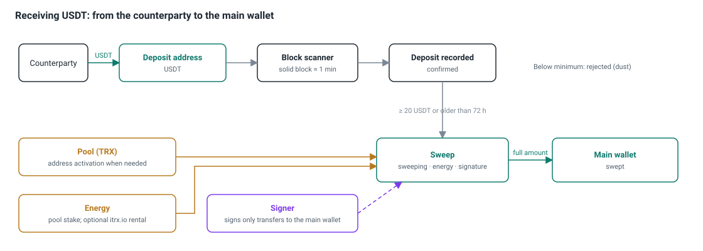

1. Under **Deposits**, check the address name, amount and `confirmed` status.
2. Default automatic collection starts at **20 USDT** or after **72 hours**. Change thresholds in Settings.
3. To collect earlier, open the address under **Addresses** and click **Sweep now**.
4. Under **Sweeps**, wait for `confirmed`. The deposit becomes `swept` and the main wallet balance increases.

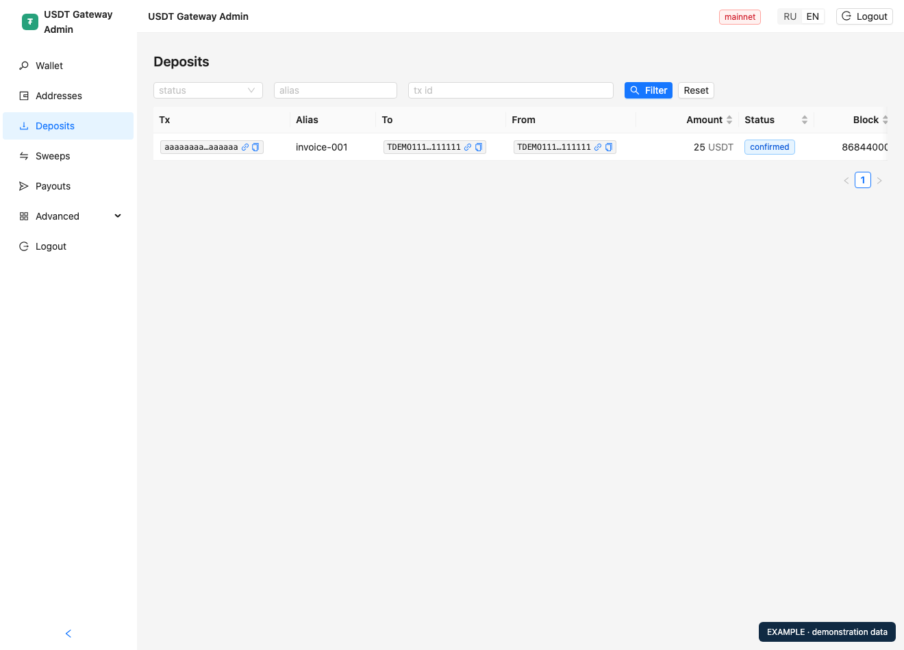

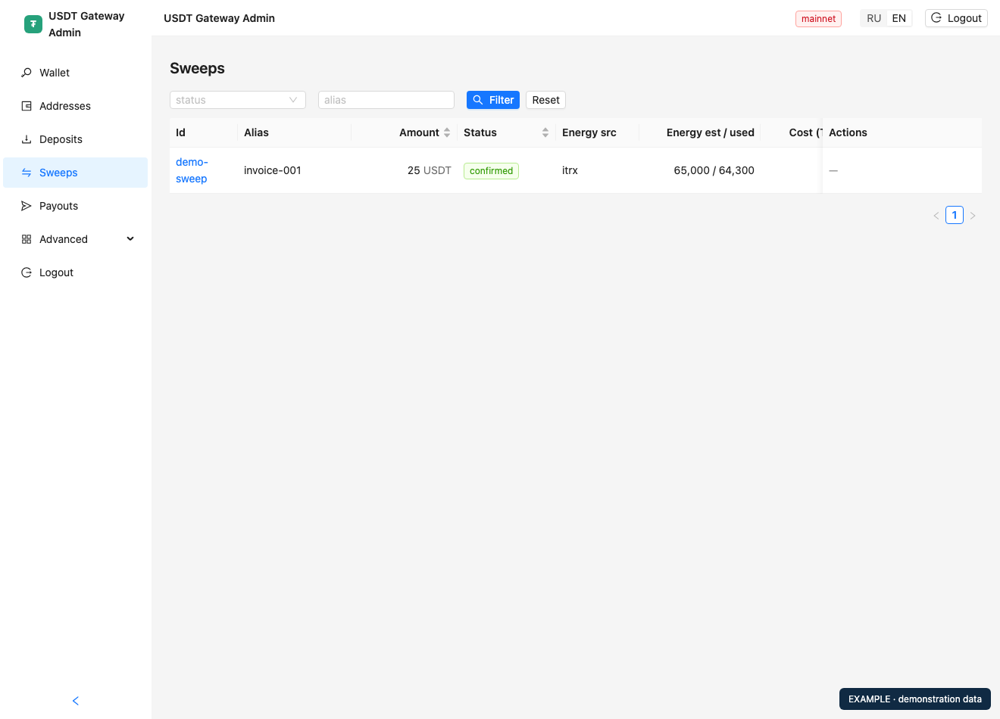

Start with a small test amount. Sweeps require queue workers; see the `RUN_WORKERS` troubleshooting entry below.

### 9. Send a payout

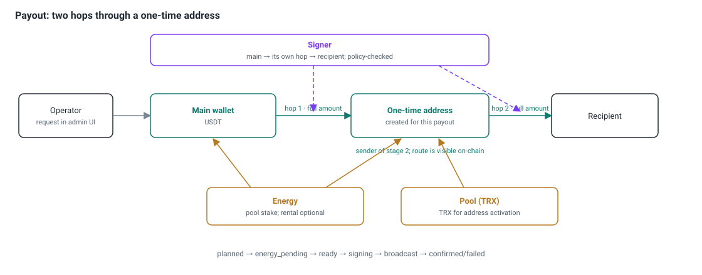

1. Open **Payouts → New payout**, or the payout button on Wallet.
2. Enter the TRON recipient address and USDT amount; verify both.
3. Supply a payout reference. Reusing it will not create a second payout. A note is optional.
4. Submit the request. The service automatically creates a separate intermediate address for this payout and sends funds in two stages: **main wallet → intermediate address → supplied recipient address**.
5. Wait for final **`confirmed`**, which confirms stage 2. Stage 1 confirmation alone is not completion.

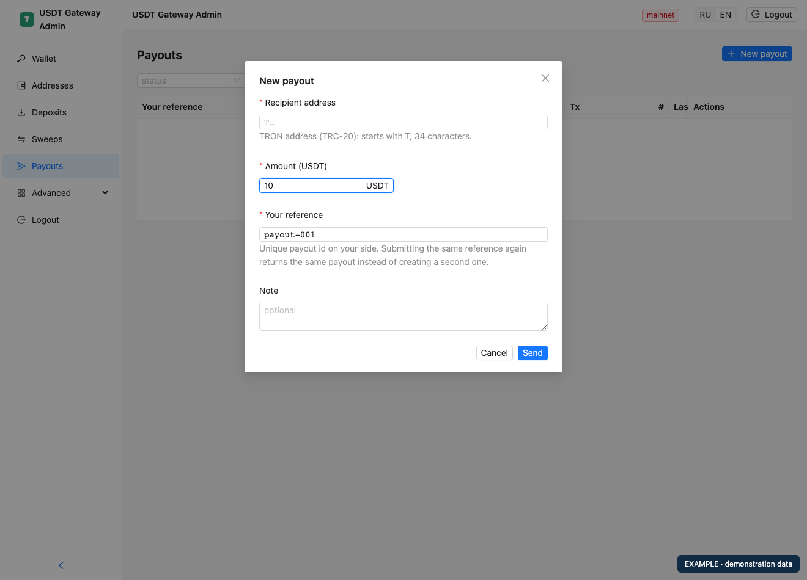

The main wallet needs USDT, the pool needs TRX for necessary expenses, and your selected Energy provider must be available. Payouts require queue workers.

### 10. Keep complete backups

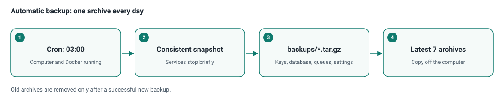

After installation, backups run **daily at 03:00 local computer time**. The latest **7 archives** remain in `backups/`; older ones are removed only after a successful new backup. The computer and Docker must be running.

**The installer configures the schedule automatically; no manual cron setup is needed.** Running the installer again updates the schedule without duplicating the job.

Back up immediately:

```bash
./scripts/backup.sh
```

Services briefly stop and restart. Copy **`backups/usdt-trx-<date>.tar.gz`** to private storage off this computer. Automatic job reports are in **`backups/daily.log`**. Manual archives in `backups/` count toward the same 7 copies.

The full archive includes keys, database, history, settings, queues, login and 2FA. Treat it as access to your funds; keep the phrase separately. **Download labels in admin does not replace a full backup.**

### 11. Restore from a backup

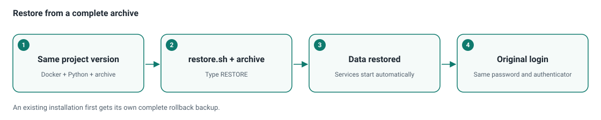

1. Prepare the new computer as in step 1 (Docker, Python, cron and `lsof`). Download the **same project version** and open a terminal in its folder.
2. Copy the archive there and run, replacing the example filename:

```bash
./scripts/restore.sh ./usdt-trx-20261005-120000.tar.gz
```

3. Type **`RESTORE`** when prompted and wait for completion.
4. Open admin and use your **original password and authenticator**. Addresses, pool, keys and records return together; no seed import is needed. The daily backup schedule is enabled too.

Restore replaces current data. An existing installation first gets a complete rollback archive in `backups/`. On failure, services stay stopped: fix the cause and retry, or restore the rollback archive.

**Only the phrase survived?** Install afresh and import it. Recover from chain can rebuild some records, but not login, settings or complete history. It can also initiate returns from one-time payout addresses.

### Troubleshooting

| Symptom | Check |
|---|---|
| Admin unavailable / 502 | Wait for `Ready`, refresh; with OrbStack try http://localhost:8080 |
| Balances fail to load | `TRONGRID_API_KEY` in `.env`; TronGrid quotas for `429` |
| No deposit appears | Sender used the issued address on TRON; watcher is running and caught up |
| Sweep or payout awaits Energy | Both itrx.io keys saved, its balance funded, the correct provider selected |
| No TRX for activation | Fund the **wallet pool**, not only the itrx.io account |
| Deposits appear, requests do not execute | `RUN_WORKERS=false` keeps the watcher but disables sweep and payout workers; normal processing needs `true` |
| No nightly archive | Computer and Docker ran at 03:00; check `backups/daily.log` |

Apply `.env` changes:

```bash
docker compose --profile full up -d --wait
```

Stop without deleting data:

```bash
docker compose --profile full stop
```

Services restart with Docker. Technical details and a separate testnet installation follow.

<details>
<summary>Developer and technical details</summary>

`RUN_WORKERS=false` disables queue workers and the scheduler; **the watcher stays enabled**. Stop scanning explicitly with `docker compose --profile full stop watcher`.

The watcher checks for new solidified blocks every **15 seconds** (`WATCHER_POLL_MS=15000`), then reads every block after its saved cursor. Payments are not skipped; polling adds up to 15 seconds to network confirmation latency. Change the interval in `.env` and recreate the watcher with `docker compose --profile full up -d --force-recreate watcher`.

`PORT` selects the host API port; use 3001 if 3000 is taken. `ADMIN_PORT` defaults to 8080. Core uses port 3000 inside Docker, and signer is on an internal network. Compose sets container paths for secrets and labels.

TronGrid: `TRONGRID_API_KEY`, `NETWORK=mainnet`, `TRON_RPC_URLS=https://api.trongrid.io`. The key covers both RPC and history queries. itrx.io defaults can be set with `ITRX_API_KEY`, `ITRX_API_SECRET`, `ITRX_RENT_PERIOD=1H`, `PROVIDER_ORDER=itrx,own_pool`; saved admin settings take precedence. Callback is optional: leave `ITRX_CALLBACK_URL` empty. Without itrx.io, use `PROVIDER_ORDER=own_pool` and stake pool TRX for energy.

For noninteractive mainnet installation, supply the `TRONGRID_API_KEY` environment variable. The installer preserves an existing `.env`. Scripts need Python ≥ 3.9, Docker Compose, cron (`crontab`) and `lsof`, with no Python packages to install.

Backup includes Postgres, Redis files, `.env`, `secrets/`, labels and signer audit logs. Checksums are verified before restore. Scripts manage the Docker stack; stop host services first. An optional backup destination is accepted: `./scripts/backup.sh /path/wallet.tar.gz`.

```bash
docker compose --profile full ps
docker compose --profile full logs -f core watcher
```

Host development requires Node ≥ 22 and pnpm ≥ 10:

```bash
pnpm install
cp .env.example .env  # only if .env does not exist
# Set SEED_PASSPHRASE, SIGNER_TOKEN and SETUP_TOKEN.
docker compose up -d postgres redis
pnpm --filter @usdt-trx/shared build
pnpm db:generate
pnpm db:migrate
# Four separate terminals:
pnpm dev:signer
pnpm dev:core
pnpm dev:watcher
pnpm dev:admin
```

Prisma reads the root `.env`. `CORE_URL` selects the API target for the dev admin proxy (:5173). `docker-compose.local.yml` is optional nginx for host development; recreate it with `--force-recreate` after a `PORT` change. Do not run host services alongside the full Docker stack.

```bash
pnpm test
pnpm typecheck
python3 -m unittest discover -s scripts -p 'test_stack.py'
STACK_INTEGRATION=1 python3 -m unittest discover -s scripts -p 'test_stack.py'
```

The final command tests installation, backup and restore in an isolated stack with a test wallet and no published ports. Build images first with `docker compose --profile full build`.

API: [docs/admin-api.md](docs/admin-api.md). Configuration: [.env.example](.env.example). Regenerate diagrams with `python3 docs/diagrams/generate.py`; [screenshot generation](docs/screenshots/README.md).

### How it is built

By default, one seed phrase derives all wallets. The signer stores the seed in an encrypted file and uses the keys in memory; Core receives public addresses and the xpub.


| Wallet | Branch | Holds | Funded by |
|---|---|---|---|
| Deposit addresses | 0 | USDT until swept; one address per counterparty/invoice | counterparty |
| Pool | 1 | TRX for activations, bandwidth and energy staking | operator |
| Main wallet | 2 | USDT: sweeps in, payouts out | sweeps |
| One-time payout addresses | 3 | USDT between the two payout stages | main wallet |

**Receiving USDT.** The operator creates an address in the admin UI and shares it with the counterparty. The watcher detects the transfer in a solidified block. Deposit statuses are `confirmed → sweeping → swept`; amounts below the minimum receive `rejected` (dust). A sweep starts at the balance threshold (20 USDT by default), the deposit age threshold (72 h), or when “Sweep now” is pressed. The service activates the address if needed, obtains energy, requests a signature and transfers USDT to the main wallet. Energy comes from the operator's own staked TRX pool; itrx.io rental is optional.


**Payouts.** The operator creates a payout in the admin UI. Stage 1: main wallet → one-time hop address; stage 2: hop address → recipient. Each stage requires energy. The signer checks that the first transfer targets the corresponding hop address. That address sends the second transfer; both transfers are visible on-chain.


**Where things live.** The isolated signer holds the seed and private keys. It signs only policy-checked transactions: sweeps, both payout stages and permitted pool operations. Core keeps the records; the database holds no wallet private keys.


</details>

<details>
<summary>Optional: Nile testnet</summary>

For a separate fresh installation without real funds:

```bash
./scripts/install.sh --network nile
```

The installer selects Nile and your own energy pool. itrx.io works on mainnet and is not needed here. Do not switch a production wallet just for testing.

**create or import the wallet** — Wallet → “Create new wallet”. Record the seed phrase shown **once** and keep it separately. “Import wallet” accepts an existing phrase. The signer saves the seed in the encrypted `SEED_FILE`. The pool and main wallet addresses are available in the admin UI.

**test coins from the faucet** — [Nile faucet](https://nileex.io/join/getJoinPage).

- Request test TRX for the **pool** address shown in the admin UI, for activation, bandwidth and staking.
- After creating the address, request test USDT for the new deposit address. Available amounts and limits are shown on the faucet page.

**create a deposit address** — Wallet → “Create address”, with an alias such as `invoice-1`. Use one address per counterparty or invoice. It also appears under Addresses; paste it into the USDT faucet for this test.

**stake pool TRX for energy** — Energy pool → Stake → ENERGY. For example, with 1000 test TRX, stake 800 and keep the remainder for activations and bandwidth. Wait for available energy to appear on the pool page. Required stake depends on network resources; insufficient energy makes a sweep wait and can cause it to fail.

**watch the deposit and sweep**

- After the watcher detects the transfer, it appears under Deposits as `confirmed`.
- Once sweep conditions are met, a sweep starts automatically: `planned → activating → energy_pending → ready → signing → broadcast → confirmed`. The transaction link opens Tronscan.
- The deposit progresses through `sweeping → swept`, and USDT reaches the main wallet. Delegated energy is released after the sweep; consumed energy recovers according to network rules.

If something goes wrong: Sweeps → Error, Retry / Rebuild; Resources lists energy operations; signer logs are in `signer-audit.log`.


</details>
